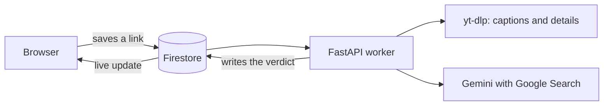

# Chestify

**Check a short-form video before you believe it.**

Paste a TikTok, YouTube Short, Instagram Reel or X video. Chestify reads what it
says, checks the main claim against the web, and shows a verdict at a glance:

| Score | Verdict |
|---|---|
| 1–3 | False |
| 4–6 | Half-truth |
| 7–10 | Mostly true |
| — | Unverified (no solid evidence either way) |

Each video gets a one-line correction and the sources behind it. You can also
chat about a video and track what you've been learning.

Live at **[chestify.atinder.dev](https://chestify.atinder.dev)**.

## Why

Short videos spread claims faster than anyone can check them. Chestify gives you a quick, sourced answer before you share or believe one.

## How it works



The browser never waits on a long request. It saves the link, the backend picks it up, and the result appears on the card as soon as it's ready.

## Stack

Next.js · Tailwind · Firebase (Auth, Firestore) · FastAPI · Google Gemini · yt-dlp

More detail in [docs/ARCHITECTURE.md](docs/ARCHITECTURE.md). Plans in
[docs/ROADMAP.md](docs/ROADMAP.md).

## Run locally

You need Node 20+, Python 3.12+, a Firebase project (Google and email sign-in,
Firestore) and a Gemini API key.

**Backend**

```bash
cd backend
python -m venv venv
venv\Scripts\activate        # macOS/Linux: source venv/bin/activate
pip install -r requirements.txt
uvicorn main:app --reload
```

`backend/.env` needs `GEMINI_API_KEY`, plus a Firebase service account at
`backend/keys/service-account.json` (or its JSON in `FIREBASE_CREDENTIALS_JSON`).

**Frontend**

```bash
cd frontend
npm install
npm run dev
```

`frontend/.env.local` needs the `NEXT_PUBLIC_FIREBASE_*` web-app keys and
`NEXT_PUBLIC_API_URL` (the backend URL).

Only run one backend against a Firestore project at a time; two would both
process every new video.

## Deploy

- **Frontend:** pushing to `master` builds a static export and deploys it to
  GitHub Pages. The `NEXT_PUBLIC_*` values are repository variables.
- **Backend:** Railway builds `backend/Dockerfile` on every push.
- **Firestore rules:** `firebase deploy --only firestore:rules`.

## Limitations and what's next

- It reads captions and video details today. Audio, on-screen text and AI footage detection are on the [roadmap](docs/ROADMAP.md).
- A verdict is a starting point, not a final ruling, so check the sources.

## Credits

Chestify started as a Sheridan College capstone project. Chahatbir Singh designed the original frontend, which the current interface builds on.

---

© Chestify 2026. All rights reserved.
